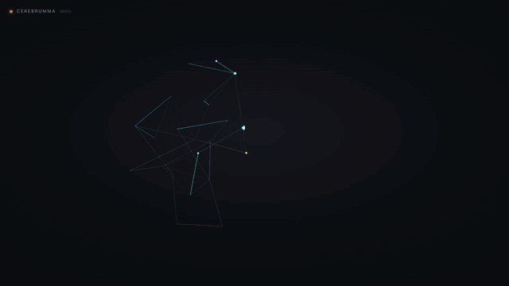

# Cerebrumma

**One Brain. Any Tool.**

<p align="center">
  <a href="https://www.cerebrumma.com">
    
  </a>
</p>
<p align="center"><em>Your whole AI memory, as a live neural map — <code>cerebrum map --graph</code></em></p>

Cerebrumma is a portable, git-tracked memory and governance layer for AI agents. It lives in `.cerebrum/` in your repo, works with Claude Code, Cursor, Antigravity and more — with built-in explainability, approval controls, and equity guardrails. No lock-in. Intelligence that compounds without letting agents invent company policy.

## Install

```sh
curl -fsSL https://get.cerebrumma.com | sh
```

Downloads a prebuilt `cerebrum` binary for your platform (no compiler needed), verifies its SHA-256 checksum against the GitHub release, installs the MCP server, and configures Claude Code automatically. Requires macOS (Apple Silicon or Intel) or Linux (x86_64). No telemetry, no account.

Prefer to read it first? It's [one short script](install.sh):

```sh
curl -fsSL https://get.cerebrumma.com -o install.sh
less install.sh
sh install.sh
```

Or with [Homebrew](https://brew.sh):

```sh
brew install BenPeralta/cerebrumma/cerebrumma
```

The tap installs the CLI only; run the one-liner above to also set up the MCP server and Claude Code integration.

## Quickstart

```sh
# Create your global Brain (once, ever)
cerebrum init --global
cerebrum add --global "I always use TypeScript strict mode"
cerebrum add --global "Never use gendered language in UI copy"

# Add a local Brain to any project
cd ~/my-project
cerebrum init
cerebrum hook install        # auto-capture every git commit

# Start the background gardener (macOS launchd)
cerebrum daemon start

# See what your Brain knows
cerebrum status

# Let the Brain reflect and self-improve (calls LLM directly)
cerebrum dream --auto

# Visualize your Brain as an interactive 3D neural map
cerebrum map --graph

# Validate approved business knowledge, then publish an agent-safe snapshot
cerebrum validate
cerebrum publish
```

## How It Works

Memory lives in five layers inside `.cerebrum/`:

```
.cerebrum/
├── memory/
│   ├── episodic/       ← what happened (auto-captured by git hook)
│   ├── semantic/       ← distilled facts and knowledge
│   ├── procedural/     ← skills and protocols (rules you follow)
│   ├── personal/       ← equity rules and preferences
│   ├── brand/          ← voice rules and approved examples
│   └── objectives/     ← company and role goals
├── runtime/
│   └── brain.json      ← validated snapshot consumed by agents
├── embeddings.db       ← local vector index (sqlite-vec)
├── logs/               ← audit trail
└── dream/              ← reflection staging area
```

Every entry is plain Markdown with YAML frontmatter — human-readable, git-diffable, no database.

## Commands

| Command | What it does |
|---|---|
| `cerebrum init` | Create `.cerebrum/` in the current project |
| `cerebrum init --global` | Create `~/.cerebrum/` shared across all projects |
| `cerebrum add "..."` | Add an episodic memory entry |
| `cerebrum add --global "..."` | Add to the global Brain |
| `cerebrum status` | Show entry counts across all memory layers |
| `cerebrum hook install` | Install git post-commit hook (auto-captures commits) |
| `cerebrum hook remove` | Remove the hook |
| `cerebrum daemon start` | Start the background watcher and auto-dreamer |
| `cerebrum watch` | Watch for file saves (foreground) |
| `cerebrum dream` | Archive episodes + generate LLM reflection prompt |
| `cerebrum dream --auto` | Automatically call LLM (Gemini/Claude) and ingest |
| `cerebrum map` | Open a beautiful HTML visualization of your Brain |
| `cerebrum brief` | Generate a "State of the Union" context file |
| `cerebrum fix` | View actionable technical debt and prune suggestions |
| `cerebrum audit` | Audit brain health and decay |
| `cerebrum search <query>` | Semantic search across the Brain |
| `cerebrum why <query>` | Contextual trace explaining "why" a rule exists |
| `cerebrum validate` | Detect conflicts, stale approvals, and unsafe runtime knowledge |
| `cerebrum publish` | Produce a deterministic, versioned runtime snapshot for agents |
| `cerebrum config` | Set LLM providers and API keys |

## Global + Local Brain Hierarchy

```sh
cerebrum init --global   # ~/.cerebrum/ — your rules, everywhere
cerebrum init            # .cerebrum/   — this project's memory
```

When both exist, they merge automatically. Your personal rules always travel with you. Project memory stays scoped to the repo.

## MCP Integration

Cerebrumma runs as a local MCP server. Claude Code, Cursor, and Antigravity can call your Brain automatically — no manual `cerebrum inject` needed.

**Claude Code** (`~/.claude/settings.json`):
```json
{
  "mcpServers": {
    "cerebrumma": {
      "command": "uv",
      "args": ["run", "--project", "~/.cerebrumma/mcp_server", "cerebrumma-mcp"],
      "cwd": "${workspaceFolder}"
    }
  }
}
```

Available MCP tools: `read_memory` · `search_memory` · `get_protocols` · `add_entry` · `get_status` · `get_business_context`

`get_business_context` reads only the validated runtime snapshot. It filters knowledge by agent role and customer-safety classification, and returns the exact Brain version and memory IDs used so every consequential action can be audited.

## Governed Business Brain

Ordinary memories remain flexible. Knowledge used by autonomous business agents is opt-in and must carry governance metadata such as `status`, `authority`, `owner`, `scope`, `customer_safe`, and `autonomy_level`. Approved runtime entries must pass validation before publication.

```sh
# Start from the included template
cp templates/business-entry.md .cerebrum/memory/procedural/policies/refunds.md

# Review conflicts and missing approvals
cerebrum validate

# Publish .cerebrum/runtime/brain.json
cerebrum publish
```

Dream-generated insights cannot become approved runtime truth without an explicit human reviewer. See [Business Brain governance](docs/business-brain.md) for the schema, conflict rules, and controlled learning flow.

## Dream Cycle (Autopilot Gardener)

The Brain can self-improve on autopilot. First, configure your LLM provider (keys are stored securely in `~/.cerebrum/config.json`):

```sh
cerebrum config set provider gemini
cerebrum config set api_key YOUR_API_KEY
```

Then, trigger a dream cycle manually or let the background daemon handle it:

```sh
cerebrum dream --auto                 # runs reflection right now
cerebrum daemon start                 # triggers automatically after 10 saturation points
```

The LLM reflection is parsed into four sections:

| Section | Destination |
|---|---|
| Key Insights | `semantic/` |
| New Rules | `procedural/skills/` |
| Equity & Bias Notes | `personal/` |
| Prune Suggestions | Viewed later using `cerebrum fix` |

## Memory Format

```markdown
---
timestamp: 2026-05-08T18:00:00Z
source_tool: cli
salience_score: 0.6
bias_flag: false
provenance: manual
---

Always prefer functional components in React.
```

## Roadmap

- [x] CLI: `init`, `add`, `status`, `hook`, `watch`, `dream`, `map`, `fix`, `brief`
- [x] Global + local Brain hierarchy
- [x] MCP server (6 tools, including role-scoped business context)
- [x] Git hook auto-capture (branch + hash + diff stats)
- [x] Autopilot Dreaming (`dream --auto`) via Gemini/Claude
- [x] Background Daemon (`launchd`)
- [x] SQLite-vec embeddings + semantic search
- [x] Visual Brain Dashboard (`map`)
- [x] Governed Business Brain validation and deterministic runtime publishing
- [ ] Templates marketplace
- [ ] Cloud sync (Pro — $24/mo)
- [ ] Team Brain (shared repo sync)

## License

MIT OR Apache-2.0
